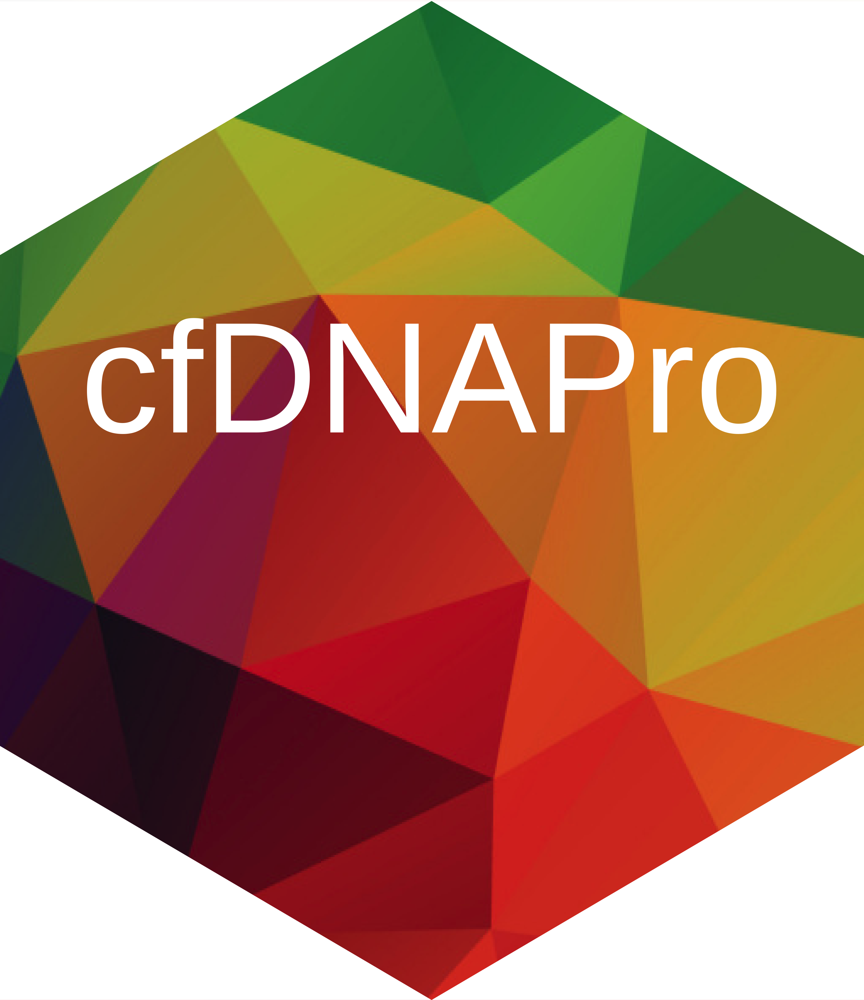

# cfDNAPro 

[](https://anaconda.org/bioconda/bioconductor-cfdnapro) [](https://anaconda.org/bioconda/bioconductor-cfdnapro) [](https://anaconda.org/bioconda/bioconductor-cfdnapro)

## Official tutorials

This landing page aims to provide a quick start. For in-depth documentation, please visit: https://cfdnapro.readthedocs.io/en/latest/

## Declaration

cfDNAPro is designed for research only.

## Why cfDNAPro?

Unlike genomic DNA, cfDNA has specific fragmentation patterns. The ambiguous definition of "fragment length" by various alignment software is raising concerns: see page 9 footnote in SAM file format spec: https://samtools.github.io/hts-specs/SAMv1.pdf\
cell-free DNA data fragmentomic analysis requires single-molecule level resolution, emphasising the importance of accurate/unbiased feature extraction. The traditional tools built for solid tissue sequencing do not consider the specific properties of cfDNA sequencing data (e.g., cfDNAs are naturally fragmented with a modal fragment size of 167bp, and di-/tri-nucleotide peaks in the length distributions). Researchers might inadvertently extract the features using a sub-optimised method.

`cfDNAPro` is designed to resolve this issue and standardize the cfDNA fragmentomic analysis, complying with the existing building blocks in the bioconductor R ecosystem. **We wish cfDNAPro to provide a catalyst for further improvements in the implementation and development of cfDNA biomarkers and multi-modal AI for various health conditions.**

## Input

A paired-end sequencing bam file, with duplicates marked. (e.g., using the MarkDuplicates function from Picard).\
Please do not impose any filtering on the bam files; For example, do not filter by the proper-pairs flag.\
`cfDNAPro` filters the reads by following default criteria (You can toggle those criteria using parameters built-in `readBam()` function):\
(1) Reads mapping qualities less than 30 were discarded;\
(2) Reads must be paired. Of note, by default, cfDNAPro doesn’t impose filtration by “proper pair”;\
(3) No duplicate;\
(4) No secondary alignment;\
(5) No supplementary alignment;\
(6) No unmapped reads.

Note: remember to choose the correct `genome_label`, a parameter in `readBam()` function, based on the ref genome you used for alignment. It supports hg19, hg38, hg38-NCBI, and `genome_label = "user_define"` with a matching BSgenome object (see the custom reference section below). For details see readBam() R documentation by typing `?readBam` in the R console or see source code:https://github.com/hw538/cfDNAPro/blob/master/R/readBam.R

## Output

`cfDNAPro` can extract (i.e., "quantify in a standandised and robust way") these features/bio-markers: - fragment length - fragment start/end/upstream/downstream motifs - copy number variation - single nucleotide mutation - more...

Feature extraction depends on essential data objects/R packages in the *Bioconductor* ecosystem, such as `Rsamtools`, `plyranges`, `GenomicAlignments`, `GenomeInfoDb` and `Biostrings`.\
Data engineering depends on packges in the *tidyverse* ecosystem, such as `dplyr`, and `stringr`.\
All plots depend on `ggplot2` R packge.

For issues/inquiries, please contact:\
Generic enquiry: **Nitzan Rosenfeld Lab admin mailbox**: bci-nrlab-admin\@qmul.ac.uk\
Fragment length, motif and CNV related questions: Haichao Wang: wanghaichao2014\@gmail.com\
SNV/SNP related questions: Paulius D. Mennea: paulius.mennea\@cruk.cam.ac.uk

## Installation

### Option 1 (recommended): Docker or Apptainer/Singularity

Release containers are built and tested by
[GitHub Actions](https://github.com/hw538/cfDNAPro/actions/workflows/container.yml)
from this repository. The image tag matches the installed R package version.

#### Docker

```bash
docker pull ghcr.io/hw538/cfdnapro:1.7.4
docker run --rm -it -v "$PWD:/work" -w /work ghcr.io/hw538/cfdnapro:1.7.4 R --no-save
```

#### Apptainer / Singularity

```bash
apptainer pull cfdnapro_1.7.4.sif docker://ghcr.io/hw538/cfdnapro:1.7.4
apptainer exec --cleanenv --bind "$PWD:/work" --pwd /work cfdnapro_1.7.4.sif R --no-save
```

Replace `apptainer` with `singularity` for Singularity installations. Confirm the
installed version with `Rscript -e 'packageVersion("cfDNAPro")'` inside the image.
The image includes the hg19, hg38, and NCBI GRCh38 BSgenome references. It targets
Linux x86-64. For repeatable analyses, use the immutable image digest recorded in
the successful workflow's summary instead of a tag.

The Dockerfile reuses the previous container's R/Bioconductor dependencies at a
pinned digest, then installs the cfDNAPro source from the checked-out commit.
Credit for that dependency environment goes to
[zetian-jia/cfDNAPro_docker](https://github.com/zetian-jia/cfDNAPro_docker).
The workflow checks the installed version and runs the installed regression suite
with networking disabled before publishing to GitHub Container Registry.

### Option 2: Install in your local R console

Release 1.7.4 was built and installed locally using R 4.3.2. In the R console:
```R
options(timeout = 3600)
if (!requireNamespace("devtools", quietly = TRUE)) {
  install.packages("devtools", repos = "https://cloud.r-project.org")
}


# Install cfDNAPro from GitHub
devtools::install_github("hw538/cfDNAPro", build_vignettes = FALSE, force = TRUE)

```

## Quick Start 1

Read bam file, return the fragment name (i.e. read name in bam file) and alignment coordinates in GRanges object in R. If needed, you can convert the GRanges into a dataframe and the fragment length is stored in the "width" column.

``` r

library(cfDNAPro)

# read bam file, do alignment curation
 frags <- readBam(bamfile = "/path/to/bamfile.bam")
# convert GRanges object to a dataframe in R
 frag_df <- as.data.frame(frags)

# You can calculate fragment length and motifs from the frags object (i.e., the output of readBam() function)

frag_length <- callLength(frags)
frag_motif <- callMotif(frags)
```

A screenshot of the output:


## Quick Start 2

Read in bam file, return the fragment length counts. A straightforward and frequent user case: calculate the fragment size of a bam file, use the following code:

``` r

# install cfDNAPro newest version 

if (!require(devtools)) install.packages("devtools")
devtools::install_github("hw538/cfDNAPro", build_vignettes = FALSE)

# calculate insert size of a bam file

library(cfDNAPro)
 frag_lengths <- read_bam_insert_metrics(bamfile = "/path/to/bamfile.bam")
```

The returned dataframe contains two columns, i.e., "insert_size" (fragment length) and "All_Reads.fr_count" (the count of the fragment length). A screenshot of the output:\


## News

### cfDNAPro 1.7.4 (October 2026)

- Custom BSgenome references and offline reference metadata, with validated
  reference recovery for motif and mutation analysis.
- Mitochondrial and sex-chromosome filtering fixes from PR #14.
- Updated roxygen documentation, dependency declarations, and versioned release
  containers built and tested in GitHub Actions.

### cfDNAPro paper is published on Genome Biology (May 2025)!

-   [Link to the paper](https://doi.org/10.1186/s13059-025-03607-5) \### cfDNAPro 1.7.3 (Jan 2025)
-   Updated various functions for mutational analysis \### cfDNAPro 1.7.2 (Jan 2025)
-   Improved various function for mutation annotation analysis etc \### cfDNAPro 1.7.1 (Jan 2025)
-   Improved the information and layout of this markdown quick start landing page \### cfDNAPro 1.7.1 (Aug 2024)
-   multiple updates \### cfDNAPro 1.7.1 (May 2023)
-   Resolved issues when building vignette
-   Various updates
-   Added/Updated readBam() functions \### cfDNAPro 1.5.4 (Nov 2022)
-   In addition to "bam" and "picard" files as the input, now we accept "cfdnapro" as input_type to various functions, this 'cfdnapro' input is exactly the output of `read_bam_insert_metrics` function in cfDNAPro package. It is a tsv file containing two columns, i.e., "insert_size" (fragment length) and "All_Reads.fr_count" (the count of the fragment length). \### cfDNAPro 1.5.3 (Oct 2022)
-   added support for hg38-NCBI version, i.e. GRCh38 \### cfDNAPro 0.99.3 (July 2021)
-   Modified vignette. \### cfDNAPro 0.99.2 (July 2021)
-   Modified vignette. \### cfDNAPro 0.99.1 (May 2021)
-   Added 'cfDNAPro' into the "watched tag". \### cfDNAPro 0.99.0 (May 2021)
-   Now cfDNAPro supports bam file as input for data characterisation.
-   Coding style improvements.
-   Documentation improvements.
-   Submitted to Bioconductor.

## Citation

Please cite this paper:

Wang, H., Mennea, P.D., Chan, Y.K.E., Cheng, Z. et al. A standardized framework for robust fragmentomic feature extraction from cell-free DNA sequencing data. Genome Biol 26, 141 (2025). https://doi.org/10.1186/s13059-025-03607-5


## Custom references and offline analysis

Custom reference support follows the proposal in
[PR #11](https://github.com/hw538/cfDNAPro/pull/11), with reference provenance and
validation added to preserve the chromosome handling introduced in PR #14.
Once cfDNAPro, its dependencies, and the reference package are installed, the
readers use local reference metadata without querying UCSC or NCBI.

```r
ref <- BSgenome.Hsapiens.UCSC.hg38::BSgenome.Hsapiens.UCSC.hg38
frag <- readBam("sample.bam", genome_label = "user_define", genome = ref,
                chromosome_to_keep = FALSE)
saveRDS(frag, "fragments.rds")
callMotif(readRDS("fragments.rds"))
```

The same `genome` argument is available in `readGALP()` and
`read_bam_insert_metrics()`. Default chromosome selection remains chr1-chr22;
set the appropriate names or FALSE for other reference naming styles/species.
New arguments follow the existing positional parameters. The older shorthand
`genome = "hg38"`, with `genome_label` omitted, also remains supported in readers.

Fragment objects store a small reference manifest, not genome sequences.
Unmodified installed reference packages are restored only when their recorded
package version and sequence metadata match. For modified or ad-hoc BSgenome
objects, supply the same `genome` explicitly to `callMotif()`,
`callTrinucleotide()`, or `writeMutTable()`. Unknown legacy assembly labels no
longer silently select hg19. Explicit references are also checked against the
fragment chromosomes, lengths, and recorded provenance.


## History / archived containers

These older third-party images predate the 1.7.4 reference-handling changes.
They are retained here for reproducing earlier analyses. Thanks to
[zetian-jia/cfDNAPro_docker](https://github.com/zetian-jia/cfDNAPro_docker)
for providing them.

### cfDNAPro 1.7.3

```bash
# Historical Docker image
docker pull zetianjia/cfdnapro:1.7.3
docker run --rm -it zetianjia/cfdnapro:1.7.3 R --no-save

# Historical Singularity image
singularity pull cfdnapro_1.7.3.sif docker://zetianjia/cfdnapro:1.7.3
singularity exec --cleanenv cfdnapro_1.7.3.sif R --no-save
```
